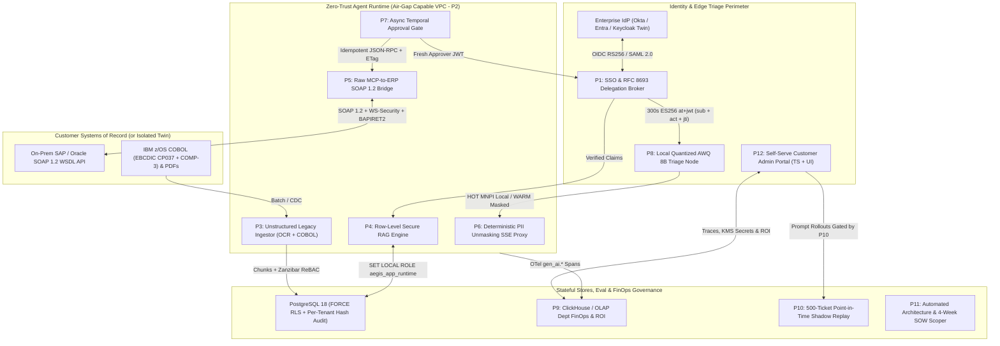

# Aegis Enterprise AI — 12-Module Zero-Trust Solution Accelerator

[](https://github.com/rnaarla/aegis-enterprise-ai/actions/workflows/ci.yml)


**Aegis Enterprise AI** is a production-grade control plane, zero-trust agent runtime, and Fortune 500 solution accelerator unifying **12 critical enterprise AI engineering capabilities** in a single modular monorepo.

It is architected around **Hexagonal Ports & Adapters + an Isolated Enterprise Digital Twin** (`enterprise_twin/`):
* **Live Fortune 500 Sales & CISO Proof-of-Value (`values-demo.yaml`):** Boots an isolated **Meridian Global Financial** digital twin (OIDC/SAML 2.0 IdP, legacy SAP ECC/S4HANA SOAP 1.2 server, binary `CP037` COBOL core-banking ledgers, multi-clearance M&A deal documents, and 500 historical operations tickets) with **zero `if demo_mode:` shortcuts** in application code.
* **Day-1 Regulated Production Cutover (`values-prod-airgap.yaml`):** Deploys the exact same `@sha256`-pinned, non-root (`UID 65532`) containers into air-gapped banking, healthcare, and government VPCs strictly via configuration swaps (Okta/Entra ID, SAP S/4HANA, AWS KMS/OpenBao, in-VPC `vLLM`).

---

## Unified System Architecture



---

## Complete 12-Project Implementation & Feature Matrix

| # | Project | Module Path | Implemented Features | Enterprise Value Demonstrated |
| :- | :--- | :--- | :--- | :--- |
| **1** | **Enterprise SSO & Agent Delegation Broker** | `services/sso_delegation_broker/` | • **RFC 8693 Token Exchange** (`urn:ietf:params:oauth:grant-type:token-exchange`) issuing RFC 9068 `at+jwt` tokens<br>• Upstream **OIDC (RS256 JWKS)** and **XXE-hardened SAML 2.0 XML** assertion verification<br>• **Triple-intersection scope narrowing** (`human_scopes ∩ agent_manifest ∩ requested_scopes`) & clearance ceiling (`min(human, agent)`)<br>• **Hard 300-second max TTL** (`exp - iat <= 300`), `act` claim (`spiffe://...`), and optional `cnf.jkt` DPoP sender-constraint<br>• **$O(\log N)$ Min-Heap TTL + $O(k)$ inverted-index revocation** & single-RTT Redis pipeline (`RedisRevocationStore`) supporting single-JTI revoke, human logout cascade, and **agent-wide emergency kill-switch**<br>• RFC 7662 `/v1/oauth/introspect` & `/.well-known/jwks.json` | Passes enterprise CISO reviews and governs non-human identities without user impersonation |
| **2** | **One-Click Air-Gapped Helm Deployer** | `deploy/` & `services/airgap_verifier/` | • Cloud-agnostic **CNCF Helm umbrella chart** (`deploy/helm/aegis`) with `values.yaml`, `values-demo.yaml`, and `values-prod-airgap.yaml`<br>• Strict **Kubernetes `NetworkPolicy`** dropping `0.0.0.0/0` public egress (allowing internal CoreDNS & VPC PrivateLink CIDRs only)<br>• **Zarf disconnected bundle** (`deploy/zarf/zarf.yaml`) & immutable `@sha256` container digest pinning<br>• **3-AZ Zero-Egress AWS VPC Terraform** (`deploy/terraform/aws_airgap_vpc/`) with PrivateLink interface endpoints (`ecr.api`, `ecr.dkr`, `kms`, `logs`, `s3`) and **zero IGW / zero NAT Gateways**<br>• Multi-stage non-root (`UID 65532`, `readOnlyRootFilesystem: true`, `HF_HUB_OFFLINE=1`) `Dockerfile` + automated **6-check static air-gap readiness auditor** (`audit_airgap.py`) | Deploys into banks, hospitals, and defense enclaves that ban public cloud egress |
| **3** | **Unstructured Legacy Ingestor** | `services/legacy_ingestor/` | • True **IBM z/OS `CP037` EBCDIC** fixed-width decoder driven by declarative COBOL Copybook specs (`ACCTLDGR`)<br>• Bit-exact **signed & unsigned `COMP-3` Packed-Decimal (BCD)** encoder/decoder (`0x0C`/`0x0D`/`0x0F` sign nibbles, overflow & corrupt-nibble guards)<br>• **Layout-aware multi-page PDF chunker** (`pypdf`) with automatic **Tesseract OCR** fallback for scanned image pages<br>• **Cross-page table header carryover** (preserving column headers when pipe tables split across page boundaries)<br>• Exact provenance tracking (`byte_offset=0x...`, page number, extraction method) & SHA-256 deterministic chunk IDs for idempotent re-ingestion | Fuels AI with messy scanned PDFs and 30-year-old mainframe COBOL exports |
| **4** | **Row-Level Secure RAG Engine** | `services/secure_rag_engine/` | • **PostgreSQL 18 kernel `ENABLE` + `FORCE ROW LEVEL SECURITY`** executed under an unprivileged `aegis_app_runtime` (`NOBYPASSRLS`) role<br>• SQL-injection-immune transaction-local identity binding via parameterized `set_config('aegis.*', ..., true)` derived **solely** from verified RFC 8693 JWTs<br>• **Defense-in-Depth Dual RLS Policies:** `PERMISSIVE` Zanzibar ReBAC user/group grants (`rebac_tuples`) intersected with `RESTRICTIVE` **Multi-Tenant Isolation + Hierarchical MAC Clearance Ceiling + Investment Banking Ethical-Wall (`ethical_wall_deny`) overrides**<br>• **Hybrid Search** combining dense cosine similarity + PostgreSQL `tsvector` GIN `ts_rank_cd` via **Reciprocal Rank Fusion (RRF, $k=60$)**<br>• LIFO `BoundedPostgresPool` with `statement_timeout = 2000ms`, **$O(T)$** streaming offline embedder, and `vLLM`/OpenAI embedding adapter | Physically prevents internal MNPI/executive data leaks inside the database kernel |
| **5** | **Raw MCP-to-ERP Bridge** | `services/mcp_erp_bridge/` & `enterprise_twin/soap_erp_mock/` | • Standards-compliant **JSON-RPC 2.0 Model Context Protocol (MCP)** server (`initialize`, `tools/list`, `tools/call`)<br>• Wraps legacy **SAP ECC / S/4HANA SOAP 1.2 + WSDL** (`BAPI_VENDOR_GETDETAIL`, `BAPI_PO_CREATE1`) with OASIS **WS-Security `UsernameToken`** headers<br>• XXE-hardened XML parser translating SAP `HTTP 200 OK` payloads with embedded `<BAPIRET2><TYPE>E</TYPE>` faults (e.g., `SPERR=X` blocked vendors) into structured MCP tool errors<br>• **$O(1)$ `BoundedLRUTTLCache` write idempotency** (`idempotency_key` deduplication + `-32009` parameter-mismatch conflict detection)<br>• Autonomous dollar-threshold enforcement (> USD 50k blocked unless approved) + `CircuitBreaker` & AWS Full-Jitter retries on flaky SOAP gateways | Gives AI standardized, idempotent hands to read/write legacy systems of record safely |
| **6** | **Deterministic PII Unmasking Proxy** | `services/pii_unmasking_proxy/` | • OpenAI-compatible `/v1/chat/completions` reverse proxy supporting **both synchronous JSON and non-blocking `text/event-stream` SSE** (`anyio.to_thread`)<br>• **Single-pass $O(L)$ master alternation regex** detecting IRS-valid SSNs, **ISO 7812 Luhn Mod-10 verified credit cards**, ISO 13616 IBANs, emails, and person names<br>• **Anaphoric & cataphoric co-reference resolution** (`"Ms. Vance"` and `"Elena Vance"` deterministically map to `<PERSON_001>` within a session)<br>• **HKDF-SHA256 + AES-256-GCM AAD-bound session vault** (`BoundedLRUTTLCache`-capped) — zero plaintext PII stored in vault memory<br>• **$O(L)$ index-cursor `StreamingSurrogateRehydrator`** (`<= 18`-byte carry buffer) reassembling surrogates split mid-tag across arbitrary SSE chunks (`["<PER", "SON_00", "1>"]`) + SHA-256 audit receipts | Satisfies PCI/HIPAA/SOC2 compliance without breaking multi-turn LLM reasoning or streaming UX |
| **7** | **Async Temporal Approval Gate** | `services/temporal_approval_gate/` | • Production **`temporalio` Python SDK** sandboxed `@workflow.defn` (`HighValuePOApprovalWorkflow`), `@workflow.signal`, `@workflow.query`, `@activity.defn`, and **72-hour SLA auto-escalation timeout**<br>• **Crash-resilient SQLite WAL coordinator** (`PRAGMA synchronous=FULL`) surviving worker `SIGKILL` / restarts while awaiting human sign-off<br>• **Slack Block Kit interactive webhook** protected by constant-time `v0` **HMAC-SHA256 signature verification** and 300-second replay-window guards<br>• **Anti-TOCTOU ERP State Verification:** snapshots SAP vendor `STATE_ETAG` during dry-run simulation and aborts commit (`ABORTED_TOCTOU_DRIFT`) if vendor bank IBAN mutates while paused<br>• Re-mints a **fresh 120s RFC 8693 token bound to the human approver's authority** at execution time | Builds legally accountable, crash-resilient human-in-the-loop autonomous workflows |
| **8** | **Local Quantized Triage Node** | `services/edge_triage_router/` | • Single-GPU **`vLLM` AWQ 4-bit 8B** (`Qwen2.5-8B-Instruct-AWQ`) HTTP adapter enforcing **`guided_json` constrained decoding** (< 64 output tokens) wrapped in `CircuitBreaker` + jittered retry, plus zero-egress deterministic on-prem classifier<br>• **3-Tier Data Gravity Routing:** `HOT_MNPI_ONPREM_ONLY` (cloud egress blocked; answered strictly inside local GPU enclave), `WARM_PII_MASK_REQUIRED` (routed through P6 PII Proxy), and `COLD_PUBLIC_CLOUD_SAFE`<br>• **Fail-Closed GPU KV-Cache Admission Control:** tracks in-flight token reservations and sheds load with `HTTP 503` when VRAM saturates — **never failing open to public cloud** | Brings quantized inference to customer GPUs when MNPI/PII data is too hot to move |
| **9** | **Department-Level FinOps & ROI Dashboard** | `services/finops_telemetry/` | • Production **ClickHouse `MergeTree` OLAP schema** (`clickhouse_finops_schema.sql`) + thread-safe WAL telemetry engine<br>• **Granular token rate cards** separating uncached input, **90%-discounted cached input reads**, reasoning tokens, output tokens, and external tool API fees<br>• Explicit **failed-retry waste accounting** (`retry_waste_usd`)<br>• **CFO-Defensible Rework-Penalized Net ROI Math:** `(verified_resolutions * baseline_mins - human_escalations * rework_penalty_mins) * loaded_hourly_rate - total_ai_spend` (exposing negative ROI if an agent over-escalates) | Prevents enterprise churn by proving net productivity ROI in CFO-grade unit economics |
| **10** | **Historical Shadow Replay Harness** | `services/shadow_replay_harness/` & `enterprise_twin/corpus_seed/historical_tickets.py` | • Replays **500 messy historical operations & support tickets** across auto-POs, > USD 50k escalations, blocked `SPERR=X` vendors, and unauthorized MNPI fishing<br>• **Strict Temporal Leakage Prevention:** injects only `world_state_at_t0` (point-in-time snapshot at ticket creation), blocking `mutated_state_today` post-resolution leaks<br>• **Zero Live ERP Side Effects:** intercepts all tool calls inside a shadow recorder (`live_erp_writes_attempted == 0`)<br>• Composable **Evans/Fowler OOAD `Specification[T]` predicates** (`&`, `|`, `~`) + **CI Release Gate** (`trajectory_accuracy >= 96%` and `0` policy violations) | Proves accuracy on the customer's own messy historical data before launch |
| **11** | **Automated Architecture Scoper** | `services/arch_scoper/` | • Structured executive discovery intake (`ScopeDiscoveryIntake`) covering compliance regimes (`FEDRAMP_HIGH`, `HIPAA`, `PCI_DSS`, `SEC_FINRA_MNPI`, `SOC2`), legacy sources, concurrency, and write limits<br>• **Deterministic Constraint Conflict Solver:** automatically flags mutually exclusive executive asks (e.g., `AIRGAP_VS_PUBLIC_LLM_API` when requesting air-gap + hosted public API) and enforces compliant self-hosted GPU / PrivateLink resolutions<br>• **Code-driven Infrastructure BOM Calculator** (exact L40S/L4 GPU count, VRAM GB, `pgvector` & ClickHouse storage, monthly run-rate USD — zero LLM math hallucinations)<br>• **STRIDE + OWASP LLM Top 10** threat-to-module matrix, syntax-verified **Mermaid diagram generator**, and **4-week SOW Markdown** with customer prerequisite gates | Translates vague executive "we want AI" requests into scoped, threat-modeled 4-week SOWs |
| **12** | **Self-Serve Customer Admin Portal** | `services/admin_control_plane/` & `apps/admin_portal/` | • Strict **TypeScript 6.0 SDK & View-Model Layer** (`strict`, `noUncheckedIndexedAccess`, `exactOptionalPropertyTypes`) with hierarchical **OpenTelemetry Trace Waterfall** builder & tenant ROI aggregator<br>• **Zero-CDN Air-Gap Safe Browser UI** (`apps/admin_portal/public/index.html`) served at `GET /ui`<br>• **Immutable Prompt Version Registry** with unified `difflib` diffs and **automated P10 500-ticket Shadow Replay Gating** (`HTTP 422` blocks promotion if an admin removes safety/threshold rules)<br>• **AES-256-GCM KMS Connector Secret Rotation** returning only masked previews (`••••••••9921`) + cryptographic separation of duties (`admin:control_plane` cannot bypass P4 RLS to read M&A deal docs) | Enables Day-2 customer IT self-sufficiency instead of permanent consulting bottlenecks |

---

## Systems Engineering Rigor, DSA & Design Patterns

* **Optimal Time & Space Complexity (`packages/aegis_core/dsa.py`):**
  * `BoundedLRUTTLCache[K, V]` (PEP 695 generic doubly-linked hash map): **$O(1)$** `get`/`put` and strict **$O(C_{\max})$** memory ceiling across PII vaults, revocation blocklists, and MCP idempotency stores.
  * `MinHeapTTLIndex[K]`: **$O(\log N)$** insertion with monotonic tie-breakers, **$O(1)$** lazy tombstones, and **$O(1)$ amortized** expiry eviction.
  * `StreamingSurrogateRehydrator`: **$O(L)$** single-pass integer-cursor scan with **$O(1)$** bounded carry (`<= 18` bytes).
  * `DeterministicFinancialEmbedder`: **$O(T)$** streaming token/bigram projection in **$O(1)$** auxiliary memory.
* **Concurrency & Database Contention (`packages/aegis_core/db_pool.py` & `audit.py`):**
  * `BoundedPostgresPool`: LIFO warm connection reuse, automatic broken-socket replacement, rollback-on-return hygiene, and `SET LOCAL statement_timeout = '2000ms'`.
  * **Per-Tenant Hash Chains & Kernel Triggers:** Independent per-tenant SHA-256 audit chains guarded by `pg_advisory_xact_lock(hashtext(tenant_id))` (zero cross-tenant lock contention), PostgreSQL `BEFORE UPDATE OR DELETE OR TRUNCATE` immutability triggers (`SQLSTATE 55000`), and **$O(1)$-RAM server-cursor streaming verification** (`fetchmany`).
* **SRE Resilience & Clean OOAD (`packages/aegis_core/resilience.py` & `http_middleware.py`):**
  * Thread-safe **$O(1)$ `CircuitBreaker`** (`CLOSED -> OPEN -> HALF_OPEN`) paired with **AWS Full-Jitter Exponential Backoff** across legacy SOAP and GPU `vLLM` clients.
  * Shared HTTP correlation layer injecting `X-Request-ID`, W3C `traceparent`, `X-Content-Type-Options: nosniff`, `/healthz`, and `/readyz` across services.
  * Martin Fowler *Extract Class* separation (`app.py` transport / domain service / repository) and Eric Evans composable `Specification[T]` (`&`, `|`, `~`) policy rules.

---

## Repository Layout

```text
aegis-enterprise-ai/
├── .github/workflows/ci.yml              # Zero-cost public Ubuntu CI (mypy, tsc, ruff, helm, tf, pytest >=95%)
├── Makefile                              # Unified typecheck, lint, IaC validation, and 3-tier test targets
├── pyproject.toml                        # Python 3.12+ dependencies & strict mypy/ruff/pytest config
├── packages/aegis_core/                  # Crypto, DSA caches/heaps, LIFO PG pool, CircuitBreaker, audit, OTel
├── services/
│   ├── sso_delegation_broker/            # [P1] OIDC/SAML -> 5m ES256 RFC 8693 Token Exchange & revocation
│   ├── airgap_verifier/                  # [P2] Static zero-egress & @sha256 bundle readiness auditor
│   ├── legacy_ingestor/                  # [P3] IBM CP037 EBCDIC + COMP-3 COBOL & pypdf/Tesseract OCR pipeline
│   ├── secure_rag_engine/                # [P4] Postgres 18 FORCE RLS + ReBAC + Ethical Wall + RRF hybrid RAG
│   ├── mcp_erp_bridge/                   # [P5] JSON-RPC 2.0 MCP server -> SAP SOAP 1.2 + WS-Security + BAPIRET2
│   ├── pii_unmasking_proxy/              # [P6] AES-256-GCM vault + O(L) streaming SSE PII unmasking proxy
│   ├── temporal_approval_gate/           # [P7] Temporal SDK workflow + WAL recovery + Slack HMAC + anti-TOCTOU
│   ├── edge_triage_router/               # [P8] vLLM AWQ 8B guided-JSON triage + fail-closed KV backpressure
│   ├── finops_telemetry/                 # [P9] ClickHouse DDL + cache/retry token rates + rework-adjusted ROI
│   ├── shadow_replay_harness/            # [P10] 500-ticket t_0 shadow evaluator + OOAD Policy Specifications
│   ├── arch_scoper/                      # [P11] Constraint solver + GPU/storage BOM + STRIDE/OWASP 4-week SOW
│   └── admin_control_plane/              # [P12] Self-serve prompt governance, KMS secret rotation & trace API
├── apps/admin_portal/                    # [P12] TypeScript 6.0 strict SDK, OTel waterfall & zero-CDN /ui HTML
├── enterprise_twin/                      # Isolated Meridian Financial IdP, SAP SOAP server, corpus & PoV runners
├── deploy/                               # [P2] Hardened Dockerfile, docker-compose, Helm chart, Zarf & AWS VPC TF
└── tests/                                # 3-Tier Suite: unit/ (incl. 500x fuzz), integration/ (32-thread), system/
```

---

## Quickstart & 3-Tier Verification Suite

```bash
# 1. Create virtualenv and install package + dev tools
python3 -m venv .venv
.venv/bin/pip install -e ".[dev]"

# 2. Run strict static analyzers (mypy --strict across 79 files + tsc --noEmit + ruff + Helm + Terraform)
make typecheck lint helm-lint tf-validate

# 3. Run individual test tiers
make test-unit          # Tier 1: Fast isolated unit tests + 500-split SSE property fuzzing
make test-integration   # Tier 2: Live Postgres 18 FORCE RLS, Temporal 72h SLA, Tesseract OCR, 32-thread races
make test-system        # Tier 3: 6-hop HTTP enterprise journey + 6-scenario CISO PoV + 12-module master PoV
make test-ts            # TypeScript 6.0 Admin Portal SDK & OTel waterfall suite

# 4. Run full verification gate (enforces >= 95% statement coverage)
make verify-all

# 5. Run interactive Fortune 500 CISO & 12-Module executive demonstrations directly
make demo-ciso
make demo-all-12
```

---

## License

Apache License 2.0 — see [LICENSE](LICENSE).
