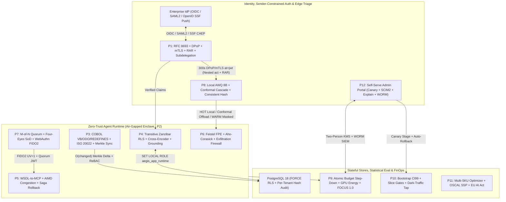

# Aegis Enterprise AI — 12-Module Zero-Trust Solution Accelerator (V2 Principal Edition)

[](https://github.com/rnaarla/aegis-enterprise-ai/actions/workflows/ci.yml)


**Aegis Enterprise AI** is a production-ready-by-design control plane, zero-trust agent runtime, and Fortune 500 solution accelerator unifying **12 critical enterprise AI capabilities** in one strictly typed, load-verified monorepo.

* **Live Fortune 500 Sales & CISO Proof-of-Value (`values-demo.yaml`):** Boots an isolated **Meridian Global Financial** digital twin (OIDC/SAML 2.0 IdP, legacy SAP ECC/S4HANA SOAP 1.2 server, `CP037`/`CP1140` `RECFM=VB` COBOL ledgers, ISO 20022 `pacs.008` wires, multi-clearance M&A deal documents, and 500 historical operations tickets) with **zero `if demo_mode:` shortcuts** in domain service code.
* **Day-1 Regulated Production Cutover (`values-prod-airgap.yaml`):** Deploys immutable `@sha256`-pinned, non-root (`UID 65532`), offline Cosign/SBOM-attested containers into air-gapped banking, healthcare, and sovereign defense enclaves strictly via outer-ring adapter wiring and configuration swaps.

---

## Unified V2 System Architecture



---

## Hexagonal Topology & Architectural Streamlining

All 101 Python modules and TypeScript SDK packages are organized into **3 concentric Hexagonal (Ports & Adapters) dependency rings**, enforced automatically on every commit via static AST import-graph assertions in [`tests/unit/test_architectural_boundaries.py`](tests/unit/test_architectural_boundaries.py) (full details and ADRs in [`docs/ARCHITECTURE.md`](docs/ARCHITECTURE.md)):

1. **Inner Kernel (`packages/aegis_core/`):** Zero imports from `services/*` or `enterprise_twin/*`. Houses frozen Pydantic Value Objects (`models.py`), structural `Protocol` Ports (`ports.py`: `TokenVerifierPort`, `TokenBrokerPort`, `MCPToolCallerPort`, `SOAPEnvelopeHandlerPort`, `AuditLedgerPort`), pure Functional Core algorithms (`pii_scanner.py`, `crypto.py`, `aimd.py`), SLI/OpenMetrics (`sli_metrics.py`), and shared FastAPI boundary middleware (`http_middleware.py`).
2. **Middle Ring (`services/<12_bounded_contexts>/`):** Zero imports from `enterprise_twin/*` or `runtime_host/*`. Peer data-plane services depend strictly on `aegis_core.ports` interfaces (**Dependency Inversion**), expose Tell-Don't-Ask facades (`finished_spans()`, `configure_budget()`, `canary_status()`, `route_prompt_version()`) enforcing **Law of Demeter**, isolate SAP SOAP 1.2 / WS-Security behind an **Anti-Corruption Layer** (`mcp_erp_bridge/soap_client.py`), and manage SQLite WAL stores via deterministic context managers (`with ...:` / `close()`).
3. **Outer Ring (`services/runtime_host/`, `enterprise_twin/`, `apps/admin_portal/`, `deploy/`, `tests/`):**
   * **Explicit Composition Root (`services/runtime_host/bootstrap.py`):** Zero-argument `--factory` entrypoint (`runtime_host.bootstrap:create_service_app_from_env`) used by `Dockerfile` / `uvicorn`, keeping all wiring out of the domain kernel.
   * **DRY HTTP Boundary Layer (`packages/aegis_core/http_middleware.py`):** Declarative `Depends(require_bearer_token)` injection and centralized `@app.exception_handler` hooks (`MissingBearerTokenError`, `TokenVerificationError`, `DelegationPolicyError`) eliminate repetitive auth/error boilerplate across all ASGI transports.
   * **Strict 3-Tier Test Pyramid (`tests/{unit,integration,system}/`):** Zero loose root test files; AST hygiene tests fail the build if any test or cross-ring import drifts.
   * **Deliberate KISS / YAGNI Discipline:** Explicitly rejects full Event Sourcing (using append-only hash-chained `audit_ledger` + ACID projections instead), eventual-consistency pub/sub buses on **PC/EC** security revocation/RLS paths, split-DB CQRS, custom Actor frameworks, and reflection-based DI containers.

---

## Complete 12-Project Implementation & V2 Principal-Tier Feature Matrix

| # | Project | Module Path | Core & V2 Principal-Tier Features Implemented | Quantitative NFR & SRE Guarantees |
| :- | :--- | :--- | :--- | :--- |
| **1** | **Enterprise SSO & Agent Delegation Broker** | `services/sso_delegation_broker/` | • **RFC 8693 Token Exchange** (`at+jwt`, 300s ceiling) over OIDC RS256 & XXE-safe SAML 2.0<br>• **RFC 9449 DPoP Proof Verification** (`htm`, `htu`, `ath`, single-use `jti` anti-replay) & **RFC 8705 mTLS (`cnf.x5t#S256`)** binding<br>• **Nested Multi-Hop Subdelegation (`act` Chain <= 3 hops)** with monotonic scope/TTL attenuation & cycle blocking<br>• **RFC 9396 Rich Authorization Requests (`authorization_details`)** narrowing PO USD ceilings & corpus sources<br>• **OpenID SSF / CAEP (`secevent+jwt`) Push Receiver** (`/v1/ssf/events`) + **Zero-Downtime `SigningKeyRing` Rotation** + `O(log N)` / Redis revocation | `p95 <= 15ms`, `p99 <= 30ms`; `99.99%` availability SLO; zero token drops across live `kid` rollover |
| **2** | **One-Click Air-Gapped Helm Deployer** | `deploy/` & `services/airgap_verifier/` | • **CNCF Helm Umbrella Chart** (`values.yaml`, `values-demo.yaml`, `values-prod-airgap.yaml`) + **Zarf** disconnected bundle<br>• **SRE Operability Manifests:** `PodDisruptionBudget`, `HorizontalPodAutoscaler v2`, `startup`/`liveness`/`readiness` probes, `preStop` `/v1/ops/drain`, and Google SRE **Multi-Burn `PrometheusRule` (14.4x / 6x)**<br>• **Supply-Chain Security:** `Kyverno` `@sha256` policy + offline **Cosign ECDSA P-256**, **SLSA v1.0 provenance**, and **CycloneDX 1.5 SBOM** 0-Critical-CVE gate (`supply_chain.py`)<br>• **Multi-Cloud Sovereign IaC:** 3-AZ AWS PrivateLink VPC + **Azure Government AMD SEV-SNP Confidential Enclave** (`0` IGW / `0` NAT) + zero-arg `--factory` non-root (`UID 65532`) `Dockerfile` | Zero-drop rolling deploys (`30s` drain); 7-point automated air-gap & supply-chain audit (`<= 250ms`) |
| **3** | **Unstructured Legacy Ingestor** | `services/legacy_ingestor/` | • **IBM z/OS `CP037`/`CP500`/`CP1140` EBCDIC** + bit-exact signed **`COMP-3` BCD** (`ACCTLDGR`)<br>• **Enterprise COBOL `RECFM=VB` (BDW/RDW)** variable-length blocks, **`OCCURS DEPENDING ON`** dynamic arrays, and discriminated **`REDEFINES`** unions (`cobol_advanced.py`)<br>• **ISO 20022 `pacs.008`** XXE-hardened institutional wire settlement parser<br>• **Layout-aware PDF + Tesseract OCR** with cross-page pipe-table header carryover & contextual late-window headers<br>• **Binary SHA-256 Merkle-Tree Incremental Sync** (`merkle_sync.py`) re-embedding only mutated pages/records | `O(changed)` delta sync skips `>= 95%` redundant embedding cost on amended filings |
| **4** | **Row-Level Secure RAG Engine** | `services/secure_rag_engine/` | • **PostgreSQL 18 `ENABLE` + `FORCE ROW LEVEL SECURITY`** under `aegis_app_runtime` (`NOBYPASSRLS`)<br>• **Transitive Zanzibar Hierarchy Closure (`aegis_effective_groups`):** cycle-safe recursive CTE (`<= 8` hops) inside Postgres RLS resolving nested user/group/deal-room grants AND **transitive `ethical_wall_deny` barriers**<br>• **Hybrid Dense Cosine + `ts_rank_cd` RRF ($k=60$)** + RFC 9396 `rag_corpus` source filtering<br>• **On-Prem Cross-Encoder Reranker** + **Deterministic Citation Grounding Verifier** (`/v1/verify-citations`, blocking unauthorized or unentailed `[chk-...]` citations) + optional constant-floor timing pad | `0` cross-tenant/clearance/wall leaks under 16-conn LIFO pool contention; `2000ms` hard `statement_timeout` |
| **5** | **Raw MCP-to-ERP Bridge** | `services/mcp_erp_bridge/` & `enterprise_twin/soap_erp_mock/` | • **JSON-RPC 2.0 MCP Server** wrapping **SAP S/4HANA SOAP 1.2 + WS-Security + `BAPIRET2`**<br>• **Automated WSDL 1.1 / XSD-to-MCP Tool Compiler** (`wsdl_compiler.py`)<br>• **Netflix `Gradient2` Adaptive AIMD Concurrency Limiter** (`aimd.py`) protecting fragile SAP ABAP dialog work processes from agent traffic storms (`-32005` fast shed)<br>• **Mandatory Pre-Flight `TESTRUN='X'` Simulation**, **Durable SQLite WAL Idempotency Outbox**, and **Multi-ERP Reverse BAPI Saga Compensation** (`BAPI_PO_CANCEL`) | `O(1)` congestion shedding (`< 2ms`); `0` orphaned POs on downstream partner failure |
| **6** | **Deterministic PII Unmasking Proxy** | `services/pii_unmasking_proxy/` | • Non-blocking sync & streaming SSE `/v1/chat/completions` reverse proxy (`anyio.to_thread`)<br>• **6-Round Keyed HMAC-SHA256 Balanced Feistel FPE** (`fpe_and_automaton.py`) emitting reversible **Luhn-valid 16-digit PANs**<br>• **True `O(L + Z)` Aho-Corasick Trie Automaton** with BFS failure links matching `10,000+` custom deal/client codenames in one linear pass + co-reference resolution + **HKDF AES-256-GCM Session Vault**<br>• **Allowlisted `tool_calls` JSON Argument Rehydration** + **Anti-Exfiltration Canary Firewall** blocking URL/image, spaced, and Base64 surrogate leaks (`HTTP 422`) | Per-chunk SSE overhead `p99 <= 5ms`; `<= 18`-byte `O(1)` carry buffer per stream |
| **7** | **Async Temporal Approval Gate** | `services/temporal_approval_gate/` | • Sandboxed **`temporalio` Workflow/Signals/Queries** (72h SLA) + **Zero-Knowledge `AESGCMPayloadCodec`** encrypting workflow histories at rest<br>• **Tiered M-of-N Quorum** (`2-of-N` >= USD 250k) & strict **Four-Eyes Separation of Duties (`requester != approver`)**<br>• **W3C WebAuthn / FIDO2 ES256 Hardware Passkey Step-Up** (`UV=1` biometric flag + challenge bound to `workflow_id \| payload_sha256 \| snapshot_etag`)<br>• **Slack Block Kit HMAC-SHA256** + **Microsoft Teams Adaptive Cards v1.5** + SAP `STATE_ETAG` anti-TOCTOU guard | Crash-durable `PRAGMA synchronous=FULL` WAL; hardware cryptographic non-repudiation |
| **8** | **Local Quantized Triage Node** | `services/edge_triage_router/` | • **`vLLM` AWQ 4-bit 8B `guided_json`** adapter (`CircuitBreaker` + full-jitter retry) + deterministic on-prem classifier<br>• **Calibrated Conformal / Shannon-Entropy Cascade (`ConformalCascadeDecider`)** resolving routine `COLD` queries locally on 8B at **USD 0.00 cloud API spend**<br>• **Bounded-Load Consistent Hash Ring (`1.25x` load factor)** maximizing `vLLM` prefix KV-cache hit rates + **Multi-LoRA Department Adapter Registry**<br>• **Weighted Fair Queuing (WFQ) Priority Lanes** (`BATCH` capped at `85%`, preserving `15%` KV headroom for `CRITICAL` traffic; **100% Fail-Closed** on saturation) | `0` unscreened cloud leaks under VRAM saturation (`HTTP 503`); `O(log V)` sticky GPU routing |
| **9** | **Department-Level FinOps & ROI Dashboard** | `services/finops_telemetry/` | • ClickHouse `MergeTree` OLAP DDL + WAL engine tracking uncached, 90%-discounted cached, reasoning, output, and retry-waste USD<br>• **Atomic Pre-Flight Budget Governor (`/v1/finops/budgets/evaluate`):** auto-downgrades `gpt-5-enterprise` -> `qwen2.5-8b-awq-local` at **80% soft cap** and hard-stops (`HTTP 429`) at **100% cap**<br>• **On-Prem GPU CapEx + Datacenter kWh/PUE Amortization** + **`O(1)` Welford Z-Score Anomaly Detector** catching runaway retry loops<br>• **Rework-Penalized CFO Net ROI** + **FinOps FOCUS 1.0** general-ledger chargeback export (`/v1/finops/focus-export`) | Budget check `p99 <= 3ms`; thread-safe atomic spend reservation under 20-way race |
| **10** | **Historical Shadow Replay Harness** | `services/shadow_replay_harness/` | • **500-Ticket `world_state_at_t0`** point-in-time shadow evaluation (`0` live ERP writes; temporal-leak detection)<br>• **Paired Bootstrap 99% Lower Confidence Bound (`accuracy_ci99_lower`)** + **Stratified Zero-Defect Slice Gates** (`100%` mandatory accuracy on `MNPI`, `SPERR=X`, and `>50k` slices)<br>• **Automated Fault-Localization Taxonomy** + **Adversarial Multi-Turn / Indirect Prompt-Injection Red-Team Suite**<br>• **Envoy-Style Dark-Traffic Shadow Mirror** (`DarkTrafficShadowMirror`) + Evans/Fowler `Specification[T]` (`&`, `\|`, `~`) | Full 500-ticket + 300-resample Bootstrap CI99 gate in `< 200ms` |
| **11** | **Automated Architecture Scoper** | `services/arch_scoper/` | • Executive discovery intake + deterministic **Constraint Conflict Solver** (`AIRGAP_VS_PUBLIC_LLM_API`)<br>• **Branch-and-Bound Multi-Objective GPU SKU Optimizer** (`NVIDIA L4` vs `L40S` vs `H100 SXM` minimizing monthly USD under `TTFT p99` & concurrency constraints)<br>• **NIST SP 800-53 Rev 5 OSCAL 1.1.2 System Security Plan (`oscal_ssp_json`)** + **EU AI Act High-Risk Articles 9–15 Conformity Dossier**<br>• **Ready-to-Apply GitOps `values-customer.yaml` Compiler**, syntax-verified Mermaid diagram, and **2,000-Trial Monte Carlo Schedule Risk Simulator** (`p50`/`p90` days) | Deterministic reproducible sizing (`0` LLM math hallucinations); ATO-ready OSCAL JSON |
| **12** | **Self-Serve Customer Admin Portal** | `services/admin_control_plane/` & `apps/admin_portal/` | • **Strict TypeScript 6.0 SDK** (`noUncheckedIndexedAccess`, `exactOptionalPropertyTypes`), **OTel Trace Waterfall**, & **Critical-Path Exclusive-Duration Flamegraph Bottleneck Analyzer**<br>• **Progressive Canary Rollout (`1% -> 10% -> 50% -> 100%`)** with **Instant Automatic SLO Rollback** on error/latency breach<br>• **Two-Person Rule Dual-Control KMS Secret Rotation** (`proposer != co_signer`) + **RFC 7644 SCIM 2.0** `/scim/v2/Groups` provisioning<br>• **Zero-Plaintext Policy Explain-Plan Simulator** (`/v1/admin/policy/explain`) + **ES256 JWS-Signed SEC 17a-4 WORM SIEM Export** + Zero-CDN `/ui` | Sub-millisecond canary rollback; cryptographic separation of duties |

---

## SRE Operability Built In (Not Bolted On)

Every HTTP service installs `install_aegis_http_layer` (`packages/aegis_core/http_middleware.py` & `sli_metrics.py`):
* **`GET /metrics`:** Prometheus OpenMetrics `0.0.4` exposition (`aegis_http_requests_total`, `aegis_http_request_duration_seconds` buckets, `aegis_http_in_flight_requests`, AIMD concurrency gauges, DPoP/SSF/FPE/Quorum/Canary counters).
* **`GET /v1/sli/summary`:** Live `p50`/`p95`/`p99` latency quantiles and **Google SRE Multi-Window Multi-Burn-Rate (`14.4x` page / `6.0x` ticket)** error-budget evaluation against `99.95%` availability SLOs.
* **`GET /readyz` & `POST /v1/ops/drain`:** Named dependency health probes and Kubernetes `preStop` graceful `SIGTERM` drain (`503 draining`) eliminating rolling-deploy connection resets.
* **Structured JSON Operational Logs:** Emits `X-Request-ID`, W3C `traceparent`, `Cache-Control: no-store`, `X-Content-Type-Options: nosniff`, and actionable `runbook_ref` links on `5xx`/budget events.

---

## Production Cutover Runbook: Bringing External & Live-Infrastructure Scope to Fruition

Automated CI verifies 100% of domain logic, static types, IaC syntax, live PostgreSQL 18 `FORCE RLS` policies, Temporal workflows, and multi-worker load/chaos NFRs locally and on GitHub Actions. Bringing the **external hardware, cloud enclave, enterprise IdP/SaaS, and live SAP ERP scope** to production fruition requires executing the 6 cutover workstreams below:

### 1. Wire Production Adapters in the Outer Composition Root (`services/runtime_host/bootstrap.py`)
By default, `create_service_app_from_env()` boots self-contained Meridian Twin adapters so local demos and container smoke tests run with zero external credentials. All production adapters already exist in the codebase and must be bound when `AEGIS_ENVIRONMENT=production` (failing fast if `enterpriseTwin.enabled=false` and any required DSN/secret is missing):
* **Audit & Retrieval (`aegis_core/audit.py`, `secure_rag_engine/store.py`):** Swap `InMemoryAuditLedger` -> `PostgresAuditLedger(dsn=AEGIS_PG_DSN)` and bind `PostgresRLSRetrievalStore(dsn=AEGIS_PG_DSN)` + on-prem `SentenceTransformer` / `vLLM` embeddings instead of `DeterministicFinancialEmbedder`.
* **Revocation & KMS (`sso_delegation_broker/revocation.py`, `pii_unmasking_proxy/vault.py`):** Swap `InMemoryRevocationStore` -> `RedisRevocationStore(redis_client)` (`AEGIS_REDIS_URL`) and inject HSM / AWS KMS / Azure Key Vault wrapping keys (`AEGIS_KMS_KEK_HEX`, `SigningKeyRing` private keys via CSI Secret Store Driver).
* **ERP & GPU Triage (`mcp_erp_bridge/soap_client.py`, `edge_triage_router/router.py`):** Swap `DirectInProcessSOAPTransport` -> `HttpSOAPTransport(endpoint_url=AEGIS_SAP_SOAP_URL)` with mTLS client certificates, and swap `DeterministicOnPremClassifierAdapter` -> an HTTP `LocalTriageModelPort` client targeting the internal `vLLM` `guided_json` endpoint (`AEGIS_VLLM_BASE_URL`).

### 2. Cloud Enclave Provisioning, Supply-Chain Signing & Air-Gapped Zarf Cutover (`deploy/`)
* **Terraform State & Apply:** Configure an encrypted remote backend (AWS S3 + KMS + lockfile or Azure Gov Storage) in `deploy/terraform/aws_airgap_vpc` or `deploy/terraform/azure_gov_enclave`, then execute `terraform plan -out=enclave.tfplan && terraform apply enclave.tfplan` to provision the 3-AZ zero-IGW/zero-NAT VPC Endpoints or `Standard_DC32as_v5` AMD SEV-SNP confidential AKS node pool.
* **OCI Build, Cosign Attestation & Digest Pinning:** Build immutable images from `deploy/docker/Dockerfile`, generate CycloneDX 1.5 SBOMs (`syft`) and SLSA v1.0 provenance, sign with hardware-backed Cosign keys (`cosign sign --key kms://...`), and replace the placeholder `sha256:1111...` digests in `deploy/helm/aegis/values.yaml` with real registry `@sha256` digests verified by `supply_chain.py` and Kyverno admission policies.
* **Disconnected Enclave Transfer:** Package images, charts, and internal root CAs via `zarf package create deploy/zarf --confirm`, transfer across the air-gap diode, mirror into the enclave registry (`zarf package deploy`), and cut over via `helm upgrade --install aegis deploy/helm/aegis -n aegis-system -f deploy/helm/aegis/values-prod-airgap.yaml`.

### 3. Physical NVIDIA GPU Node Bring-Up & Offline Model Staging (`edge_triage_router` & `secure_rag_engine`)
* **GPU Infrastructure:** Provision GPU worker nodes (`NVIDIA L4`, `L40S`, or `H100 SXM` per `arch_scoper` BOM) running the NVIDIA GPU Operator and DCGM Exporter (scraping GPU kWh/utilization into Prometheus/FinOps).
* **Air-Gapped Weights & Conformal Calibration:** Pre-stage SHA-256-verified weights (`Qwen2.5-8B-Instruct-AWQ`, department LoRA adapters, dense embedding & cross-encoder reranker models) onto encrypted read-only PVCs mounted with `HF_HUB_OFFLINE=1` and `TRANSFORMERS_OFFLINE=1`. Calibrate `ConformalCascadeDecider` threshold $\hat{q}_{1-\alpha}$ against 500+ labeled customer prompts and validate live `TTFT p99` and `85%`/`15%` WFQ KV-cache shedding under load.

### 4. Enterprise IdP, SPIFFE mTLS, Collaboration SaaS & Hardware FIDO2 Cutover
* **Corporate IdP & SCIM/SSF (`sso_delegation_broker`, `admin_control_plane`):** Register Aegis with Okta, Microsoft Entra ID, or PingFederate; configure live `oidcIssuerUrl` / JWKS URI, upload SAML 2.0 SP metadata/X.509 certificates, wire SCIM 2.0 group push to `/scim/v2/Groups`, and point the IdP's OpenID SSF / CAEP transmitter at `POST /v1/ssf/events` for sub-second session/risk revocation. Deploy SPIRE Server/Agent to issue short-lived X.509 workload SVIDs (`spiffe://<customer-domain>/agent/...`) for RFC 8705 mTLS binding.
* **Temporal Cluster, Slack/Teams & WebAuthn (`temporal_approval_gate`):** Deploy a production multi-node Temporal Server cluster backed by PostgreSQL/Cassandra running dedicated `HighValuePOApprovalWorkflow` workers with KMS-keyed `AESGCMPayloadCodec`. Register the Slack App Interactivity URL (`POST /v1/webhooks/slack/interactive`, binding `SLACK_SIGNING_SECRET`) and/or Microsoft Teams Adaptive Cards v1.5 bot endpoint, and enroll executive approvers' FIDO2 hardware passkeys (YubiKey Bio / platform authenticators with `UV=1`) under the production Relying Party ID (`rp_id`).

### 5. Live SAP S/4HANA / ECC NetWeaver ABAP & Stateful Data Tier Cutover
* **SAP `SOAMANAGER` & WSDL Onboarding (`mcp_erp_bridge`):** Expose `BAPI_PO_CREATE1`, `BAPI_PO_CHANGE`, and vendor-master RFCs via SAP NetWeaver `SOAMANAGER` over TLS 1.3 / mTLS with a least-privilege SAP Communications User; export customer WSDL 1.1 / XSD schemas through `wsdl_compiler.py`, verify mandatory `TESTRUN='X'` pre-flight and `BAPI_PO_CHANGE` (`DELETE_IND='L'`) Saga rollback in SAP `QAS`, and cap `AIMDConcurrencyLimiter.max_limit` strictly below SAP's `rdisp/wp_no_dia` dialog work process allocation.
* **HA Stateful Persistence & WORM Storage:** Provision HA PostgreSQL 18 (`pgvector` + `001_rls_schema.sql` migration + `aegis_app_runtime` `NOBYPASSRLS` role via PgBouncer transaction/session pooling), Redis Cluster/Sentinel (`RedisRevocationStore`), ClickHouse `ReplicatedMergeTree` (`finops_telemetry` DDL + FOCUS 1.0 ERP GL export), and an AWS S3 Object Lock (`COMPLIANCE` mode) or Azure Immutable Blob bucket receiving signed SEC 17a-4 WORM audit bundles.

### 6. Pre-Traffic Go-Live Sign-Off Checklist
- [ ] `verify_airgap_bundle_readiness()` + `verify_container_supply_chain()` pass `100%` against real registry `@sha256` digests, Cosign signatures, and 0-Critical-CVE CycloneDX SBOMs; unsigned test pods are rejected by Kyverno.
- [ ] Live egress firewall drill confirms `0.0.0.0/0` outbound TCP/UDP/DNS from `aegis-system` pods is dropped at both Kubernetes `NetworkPolicy` and VPC/NSG layers.
- [ ] Live PostgreSQL 18 `FORCE RLS` smoke drill with real corporate IdP tokens proves `0` cross-tenant, clearance, or `ethical_wall_deny` leakage under concurrent pool load.
- [ ] End-to-end SAP `QAS` Purchase Order drill verifies `TESTRUN='X'` pre-flight, `> USD 50k` Slack/Teams pause, FIDO2 `UV=1` step-up signature, TOCTOU `STATE_ETAG` drift abort, and downstream Saga rollback.
- [ ] Synthetic `5xx` fault injection triggers Prometheus `14.4x` multi-burn alert to PagerDuty/Opsgenie within `< 2 min` and auto-rolls back `admin_control_plane` canary weight to `0%`.

---

## Quickstart & 4-Tier Verification Suite

```bash
# 1. Create virtualenv and install package + dev tools
python3 -m venv .venv
.venv/bin/pip install -e ".[dev]"

# 2. Run strict static analyzers & IaC validators (mypy --strict across 101 files + tsc 6.0 + ruff + Helm + AWS/Azure TF)
make typecheck lint helm-lint tf-validate

# 3. Run individual verification tiers
make test-unit          # Tier 1: Unit, AST Hexagonal boundary fitness, property fuzzing, crypto, FPE/Aho-Corasick
make test-integration   # Tier 2: Live Postgres 18 Transitive RLS, Temporal 72h SLA, Quorum/FIDO2, OCR, Drain
make test-system        # Tier 3: 6-hop HTTP enterprise journey + CISO PoV + 12-module master PoV
make test-load          # Tier 4: Multi-worker concurrent burst load, SAP AIMD chaos & NFR latency/leak gates
make test-ts            # TypeScript 6.0 Admin Portal SDK, Canary/Explain/WORM & Flamegraph suite

# 4. Run full release gate (enforces >= 95% statement coverage across 5,600+ statements)
make verify-all
```

See [`docs/ARCHITECTURE.md`](docs/ARCHITECTURE.md) for the concentric Hexagonal dependency rings, applied engineering principles, and explicit YAGNI / First-Principles ADRs.

---

## License

Apache License 2.0 — see [LICENSE](LICENSE).
