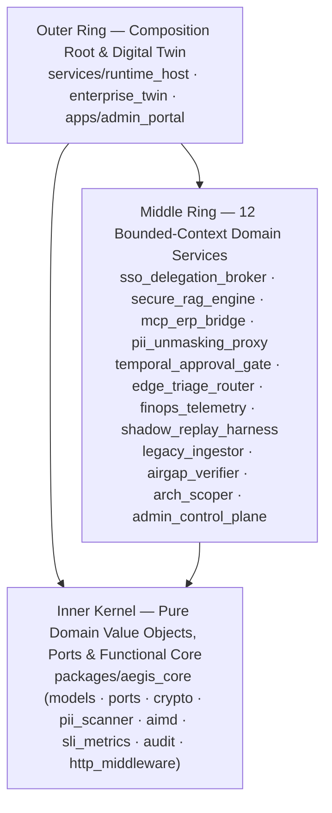

# Aegis Enterprise AI — Architecture, Hexagonal Topology & Design Principles

## 1. Concentric Hexagonal Dependency Rings (Ports & Adapters)

All Python packages enforce strict inward-only dependencies verified statically on every commit by [test_architectural_boundaries.py](file:///Users/rnaarla8/.gemini/antigravity/scratch/aegis-enterprise-ai/tests/unit/test_architectural_boundaries.py):

- **Inner Kernel (`packages/aegis_core`):** Zero imports from `services/*` or `enterprise_twin/*`. Houses immutable Pydantic `frozen=True` Value Objects (`DelegatedTokenClaims`, `HumanPrincipal`, `DocumentChunk`, `JSONRPCRequest`, `HistoricalSupportTicket`), structural `Protocol` ports (`TokenVerifierPort`, `TokenBrokerPort`, `MCPToolCallerPort`, `SOAPEnvelopeHandlerPort`, `AuditLedgerPort`), pure Functional Core algorithms (`pii_scanner.py`, `crypto.py`, `aimd.py`), and shared FastAPI boundary middleware (`http_middleware.py`).
- **Middle Ring (`services/<12_bounded_contexts>`):** Zero imports from `enterprise_twin/*` or `runtime_host/*`. Peer data-plane services communicate strictly through `aegis_core.ports` interfaces rather than concrete sibling classes. `admin_control_plane` acts as an explicit Control-Plane Backend-for-Frontend (BFF) orchestrating `finops_telemetry` and `shadow_replay_harness`.
- **Outer Ring (`services/runtime_host` & `enterprise_twin`):** Explicit Dependency Injection Composition Root (`runtime_host.bootstrap:create_service_app_from_env`) that wires production environment adapters or local Meridian Financial Twin adapters at process startup.

---

## 2. Core Zero-Trust & Database-Kernel Invariants

1. **Non-Human Identity Delegation (RFC 8693 + RFC 9449 DPoP + RFC 8705 mTLS):** Agents never impersonate humans. Every agent token binds `sub` (verified human principal), `act.sub` (SPIFFE ID of the acting agent), `cnf` (`jkt` / `x5t#S256` sender constraint), `jti` (revocable UUID), `clearance = min(human.clearance, agent.max_clearance)`, and hard `exp - iat <= 300s`.
2. **Database-Kernel Isolation (PostgreSQL 18 `FORCE ROW LEVEL SECURITY`):** Retrieval connections execute `SET LOCAL ROLE aegis_app_runtime` (`NOBYPASSRLS`) and bind session context strictly via parameterized `set_config(..., is_local := true)` calls sourced from verified JWT claims.
3. **Defense-in-Depth Dual RLS Policies:**
   - `aegis_rebac_positive_grant` (`AS PERMISSIVE`): Evaluates transitive Zanzibar group closure (`WITH RECURSIVE effective_groups`, depth <= 5) against `rebac_tuples`.
   - `aegis_mandatory_zero_trust_guard` (`AS RESTRICTIVE`): Enforces hard `tenant_id` equality, Mandatory Access Control (`clearance_required <= current_clearance`), and Investment Banking Ethical Wall (`ethical_wall_deny`) exclusions.
4. **Cryptographic & Kernel-Immutable Audit Trail:** Every token exchange, denial, revocation, tool call, and retrieval appends a `SHA256(prev_hash || canonical_json)` record to `audit_ledger`, guarded by PostgreSQL `BEFORE UPDATE OR DELETE OR TRUNCATE` triggers (`SQLSTATE 55000`).

---

## 3. Applied Principles & Modern Distributed Patterns

| Principle / Pattern | Concrete Implementation in Aegis |
| :--- | :--- |
| **Program to an Interface / Dependency Inversion** | `TokenVerifierPort`, `TokenBrokerPort`, `MCPToolCallerPort`, `SOAPEnvelopeHandlerPort`, `IdentityProviderPort`, `RevocationStorePort`, `RetrievalStorePort`, `AuditLedgerPort` (`typing.Protocol` in `aegis_core/ports.py`). |
| **DRY & Rule of Three (Boundary Error Handling)** | Centralized `require_bearer_token` FastAPI `Depends` + `@app.exception_handler` hooks in `aegis_core/http_middleware.py` eliminate repetitive bearer-parsing and `try/except` blocks across 8 ASGI services. |
| **Separation of Concerns / Functional Core, Imperative Shell** | Pure stateless algorithms (`aegis_core/pii_scanner.py`, `legacy_ingestor/cobol_ebcdic.py`, `shadow_replay_harness/statistical_eval.py`, `arch_scoper/optimizer_oscal.py`) are isolated from stateful SQL/HTTP/Temporal shells. |
| **Law of Demeter & Tell, Don't Ask** | Callers invoke `telemetry.finished_spans()`, `finops.configure_budget(...)`, `cp.canary_status()`, and `cp.route_prompt_version(...)` instead of traversing internal collaborator graphs (`a.b.c.do()`). |
| **Anti-Corruption Layer (ACL)** | `mcp_erp_bridge/soap_client.py` & `wsdl_compiler.py` isolate legacy SAP SOAP 1.2 XML namespaces, WS-Security headers, and HTTP-200 `BAPIRET2` `TYPE='E'` quirk semantics behind clean MCP JSON-RPC tools. |
| **Saga + Durable Transactional Outbox + Idempotency Key** | `MCPERPBridgeServer.execute_po_with_downstream_saga` executes compensating `BAPI_PO_CHANGE` (`DELETE_IND='L'`) rollbacks on downstream failure, backed by WAL SQLite `DurableIdempotencyOutbox`. |
| **Backpressure, Bulkhead & Fail-Closed Design** | TCP-Vegas `AIMDConcurrencyLimiter` (`aegis_core/aimd.py`) sheds SAP overload in `O(1)`; `PriorityCascadeScheduler` (`edge_triage_router`) reserves 15% GPU KV-cache for `CRITICAL` traffic and fails closed on MNPI saturation. |
| **CAP / PACELC Explicitness** | Security revocation (`sso_delegation_broker`), PostgreSQL RLS (`secure_rag_engine`), and FinOps budget reservation (`finops_telemetry`) choose **PC/EC** (strict consistency / fail-closed); telemetry export chooses **PA/EL**. |
| **Data Gravity / Locality** | Vector cosine similarity + BM25 RRF + transitive ReBAC ACL filtering execute inside PostgreSQL 18 (`001_rls_schema.sql`) before rows leave the database kernel; `HOT_MNPI` prompts stay inside the on-prem GPU enclave. |

---

## 4. Deliberate YAGNI / KISS Rejections (First-Principles ADRs)

1. **Rejected: Full Event Sourcing for Domain State.** Reconstructing active POs or prompt versions by folding unbounded event streams adds schema-upcasting tax without benefit. We keep an **append-only hash-chained `audit_ledger`** for non-repudiation while storing current projections in standard ACID tables.
2. **Rejected: Asynchronous Pub/Sub Event Bus (Kafka/RabbitMQ) on Auth/RAG Security Paths.** Asynchronous eventual consistency creates revocation race windows where a terminated employee's agent token could still read MNPI. Token verification, SSF CAEP revocation, and RLS enforcement remain synchronous CP paths; durable async orchestration is scoped strictly to multi-day human approvals via **Temporal** (`temporal_approval_gate`).
3. **Rejected: Reflection-Based DI Containers.** Python `Protocol` constructor injection + a single explicit 95-line factory (`services/runtime_host/bootstrap.py`) gives `mypy --strict` compile-time verification with zero runtime reflection magic.
4. **Rejected: CQRS Split Databases & Actor/CSP Frameworks.** At current read/write cardinality, PostgreSQL 18 handles OLTP + HNSW/RRF reads in one ACID boundary without read-replica lag bugs, and Python `asyncio` + bounded `ThreadPoolExecutor` + Temporal workflows solve concurrency without bespoke Actor mailboxes.
